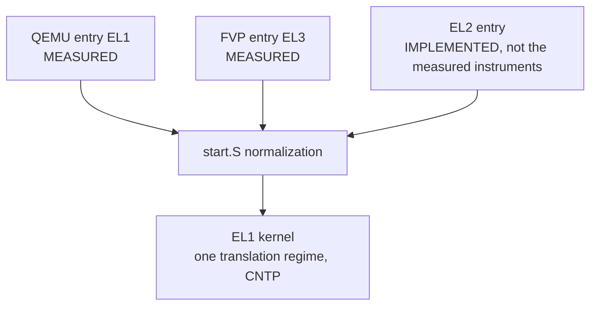
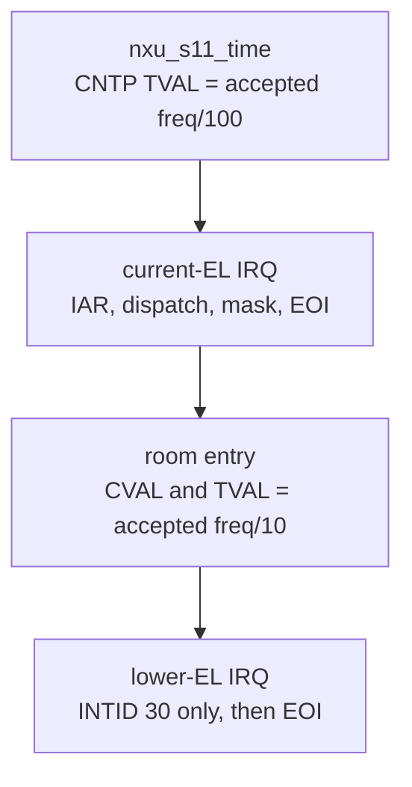
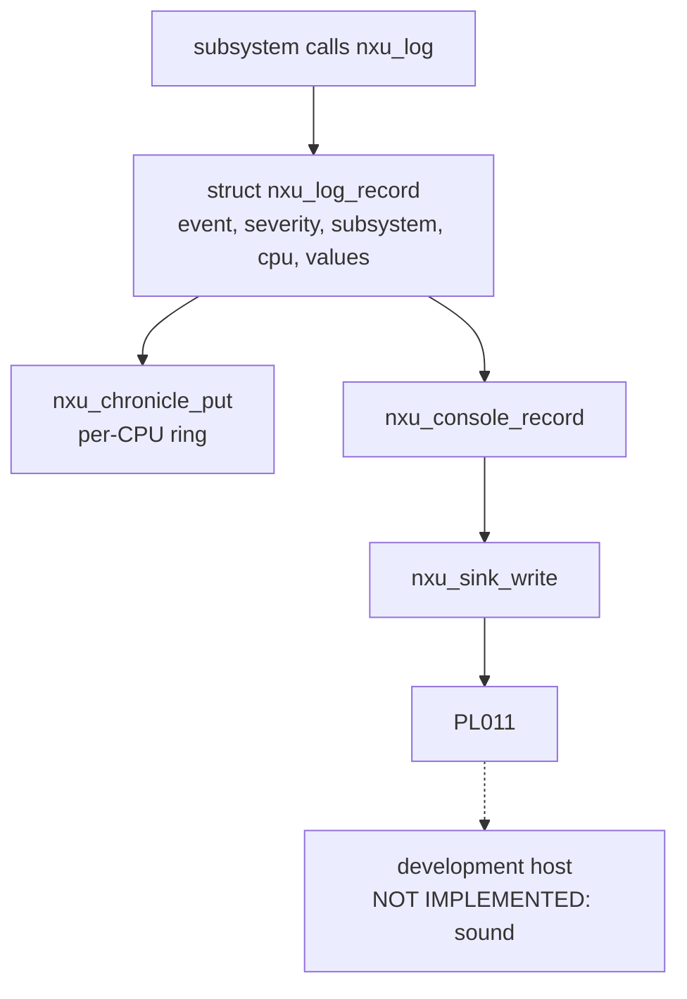

# Foundation map

Genesis v2 + closure. S0–S14 names remain. Rooms and pulses are implemented in `foundation/room/`. Wall, Edge, and Fabric are not in the TCB. UDP is not defined.

Maps live in source files. This file is an index.

```
Hardware
   │
   ▼
silicon/aarch64          operations, addresses as parameters
   │
   ▼
board/*                  candidate facts only
   │
   ▼
foundation/enter.c       S0 → S14, then rooms, then halt
   │
   ├── intake/           S0 S1
   ├── contract/         S2
   ├── facts/            S3 S4
   ├── space/            S5 S6
   ├── exception/        S7
   ├── context/          nxu_cpu_exec_context
   ├── cpu/              present set, per-CPU init, secondary release
   ├── signal/           S10 S13
   ├── time/             S11
   ├── room/             two rooms, one pulse edge, one deadline
   └── observe/          chronicle, Black Box, console, S14
```

## EL normalization — IMPLEMENTED

Steady kernel execution is EL1. The platform entry level is not that level.



Preserved across the drop: image, firmware arguments x0–x3, incoming SP value, NXU stack installed after the drop, Non-secure state when the drop started at EL3.

Discarded as a kernel world: EL2 execution, HCR_EL2.TGE, CNTHP as the kernel timer. EL2 registers are written only so EL1 can exist (RW) and so CNTP is not trapped (CNTHCTL_EL2 EL1PCTEN|EL1PCEN).

EL1 is the steady state because one kernel regime has one timer, one stage-1 translation, and one VBAR. EL3 remains a fail-closed transition shell on the FVP path.

Measured on 2026-09-26, after the Secure group assignment and the room re-arm: both QEMU and FVP reach `[NXU] NXU kernel execution is established.` and then `[NXU] The first NXU application has completed.` The earlier `ISENABLER0=0` reading was the Non-secure view of a PPI that was still Secure. That failure is H9. QEMU does not take the EL3 path.

`probe/` executes artifacts. `research/` is not linked.

Artifacts: `build-qemu/`, `build-fvp/`, `build-debug/`.

## Interrupt delivery — IMPLEMENTED

The EL2 / PPI 26 halt is historical. H9 records it. The current image is EL1, CNTP, INTID 30, on both instruments.



A room deadline that is not ahead of `CNTPCT_EL0`, or that still has ISTATUS set, halts before EL0 entry. The FVP capture that showed compare `0x2dbcb6` behind counter `0x2dc04e` is H10.

## CPU topology — IMPLEMENTED

CPU identity is the MPIDR affinity, Aff3.Aff2.Aff1.Aff0. A cluster in the narrative is the set of CPUs that share Aff2. QEMU's four CPUs are one cluster: Aff0 is 0..3. FVP Base RevC, with affinity shifted, uses Aff1 as the core and Aff2 as the cluster. Eight CPUs, two clusters of four, were measured from the redistributors after the launch exposed both clusters.

The present set comes from the DTB when one exists, checked against the board list, or from the board list when the DTB is absent. Redistributors are matched to those CPUs by affinity. They are not counted to invent CPUs.

A secondary on FVP is released by the board power controller and drops from EL3 to EL1 before it is online. QEMU's secondaries arrive through HVC to the firmware. Both paths require EL1, the NXU vectors, and that CPU's redistributor before the online line.

Measured 2026-09-27: QEMU 4 present, 4 online. FVP 8 present, 8 online. CPU 0 sent an IPI to every other CPU. On FVP, CPU 1 and CPU 4 each sent one back.

Rooms are still entered on the boot CPU.

## Rooms — IMPLEMENTED

Two rooms. One active. Room 0 is the root. Room 1 is owed one entry by an authorized pulse. A second pulse before that entry refreshes the eight-byte slot and does not owe a second entry. The kernel enters a room on the CPU that is running the entry, which is the boot CPU. Other CPUs stay in their wait loop.

Hardware that enforces the boundary: stage-1 AP and UXN/PXN, CNTKCTL_EL1 (EL0 physical timer and counter trapped), and the GIC (a room interrupt that is not CNTP ends the room). Software that establishes it: `foundation/room/room.c`.

| Edge | Permitted | Rejected, and what happened |
|---|---|---|
| Room reads or writes the other room | no | fault, canary unchanged, kernel continues |
| Room reads kernel text or the UART | no | fault, later sentences still printed |
| Room fetches its data page or another room's code | no | fault |
| Room writes its own code | no | fault, first instruction unchanged |
| Room writes CNTP_TVAL | no | fault, compare unchanged |
| Room 0 pulse, destination 1, payload `0x5055`, pointer in its data page | yes | eight bytes copied, one entry owed |
| Wrong destination, wrong payload, pointer outside the page, pulse from room 1 | no | no copy, no entry |
| CNTP expires while a room is in EL0 | kernel deadline | room preempted, kernel resumes |
| Any other interrupt during a room | no | room ended, interrupt deactivated, kernel resumes |

Not measured: cache and speculation interference. No DMA master is owned by a room. UDP is not defined. There is one edge, 0 to 1, and one slot.

## Observation — IMPLEMENTED



KERNEL emits the record. The console serializes it as an `[NXU]` sentence. The sink writes bytes. Host sound is not in this tree. The probe sync lines are `[NXU] NXU kernel execution is established.` and `[NXU] The first NXU application has completed.` `[NXU] Halted` fails the probe.

NOT IMPLEMENTED: vintage mechanical sound. PROPOSED only as a host consumer of those lines.
